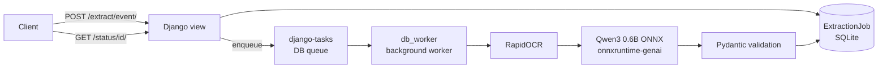

# Gumastan

A small Django demo project that shows two things:

1. **Running a web server together with background command workers** using
   [`django-melnottam`](https://pypi.org/project/django-melnottam/).
2. **A fully local image → text → structured JSON pipeline** built on top of
   that worker setup: OCR first, then a small ONNX language model, with the
   result validated against a Pydantic schema.

This is a demonstration of things to come, not a production-ready service.

## Disclosure: how this was built

The ideas, the overall shape of the project, and the model choices come from
my own research and experimentation — for example, running a small CPU-only
ONNX model locally next to a conventional OCR step, and supervising the web
server and its job worker from one process tree.

The implementation details are largely LLM-crafted. Django wiring, prompts,
schemas, the model download/build plumbing, and much of the code were drafted
with a coding LLM and then reviewed, adjusted, and run locally. Treat this
repository as a demonstration of the ideas rather than a reference
implementation, and verify anything you intend to rely on.

## How it works



The web process and the worker process are started and supervised together by
the `web-with-command-workers` entry in `PRODUCTION_PROCESSES`
(`gumastan/settings.py`), using django-prodserver with the
`ProcessWorkerServer` backend from `django-melnottam`.

## Requirements

- Python 3.14+
- [uv](https://docs.astral.sh/uv/)
- Docker (optional, for the container flow)
- ~1 GB of free disk for the ONNX model

## Quick start

```sh
# Install dependencies
uv sync

# Download the extraction model (~500 MB, not committed to git)
uv run python scripts/download_models.py

# Set up the database
uv run python manage.py migrate

# Start the web server and the db_worker in one process tree
uv run python manage.py server web-with-command-workers
```

The app is now at <http://localhost:8000>.

Equivalent local development flow, if you prefer separate terminals:

```sh
uv run python manage.py runserver
# in another terminal:
uv run python manage.py db_worker
```

Sanity checks:

```sh
uv run python manage.py check
uv run python scripts/check_setup.py
```

## API

| Method | Path | Description |
| --- | --- | --- |
| `GET` | `/health/` | Liveness check |
| `POST` | `/extract/<task>/` | Queue an extraction job. The only task today is `event` |
| `GET` | `/status/<job_id>/` | Poll a job's status and result |

Submit an image as a multipart upload:

```sh
curl -X POST http://localhost:8000/extract/event/ \
  -F "image=@flyer.jpg"
# {"job_id": 1, "status": "pending"}
```

Or as a raw image body:

```sh
curl -X POST http://localhost:8000/extract/event/ \
  -H "Content-Type: image/png" \
  --data-binary @flyer.png
```

Then poll for the result:

```sh
curl http://localhost:8000/status/1/
```

```json
{
  "job_id": 1,
  "status": "succeeded",
  "task_name": "event",
  "created_at": "2026-10-25T08:00:00+00:00",
  "finished_at": "2026-10-25T08:00:05+00:00",
  "result": {
    "title": "Example Event",
    "start_date": "2026-11-01",
    "start_time": "19:00",
    "end_time": null,
    "location": "Example venue",
    "description": null
  }
}
```

When `DEBUG` is on, you can also send `{"image_path": "/path/to/local/file"}`
as JSON instead of uploading the bytes.

## Docker

```sh
docker compose up --build
```

The image downloads the ONNX model during the build, so the container has no
runtime model download. `docker-compose.yml` caps the container at 2 CPUs and
2 GB of memory.

## Configuration

| Setting | Environment variable | Default | Purpose |
| --- | --- | --- | --- |
| `EVENT_MODEL_PATH` | `EVENT_MODEL_PATH` | `./models` | Directory with `genai_config.json`, `config.json`, `tokenizer.json`, `model.onnx` |
| `DEBUG` | — (set in `settings.py`) | `True` | Enables Django debug mode and local file paths in requests |
| `MAX_BODY_BYTES` | — | 20 MiB | Maximum upload size |

## Project layout

```
core/
  extraction/     OCR, ONNX LLM wrapper, generic extraction pipeline
  pipelines/      Task registry: prompt + Pydantic schema per task
  tasks.py        django-tasks background job (run_extraction)
  models.py       ExtractionJob tracking model
  views.py        HTTP endpoints
gumastan/
  settings.py     django-tasks backend + django-melnottam process config
models/           Downloaded model files (gitignored)
scripts/
  download_models.py   Fetch the CPU ONNX model from Hugging Face
  check_setup.py       Pre-download OCR weights and verify model files
```

## Adding a task

Tasks are just a prompt plus a response model. Create a `TaskConfig` in
`core/pipelines/` and register it in `core/pipelines/__init__.py`:

```python
TASKS = {
    "event": EVENT_TASK,
    "receipt": RECEIPT_TASK,
}
```

The OCR layer, model, tokenizer, and worker are shared, so no new model needs
to be loaded.

## Model

The pipeline uses
[`onnx-community/Qwen3-0.6B-ONNX`](https://huggingface.co/onnx-community/Qwen3-0.6B-ONNX),
CPU int4 variant. Model files are large and are **not** committed to git:

```sh
uv run python scripts/download_models.py
```

The script downloads only the CPU variant and copies its files to the top
level of `models/`. Relative to the upstream repo those files live in
`onnxruntime/cpu_and_mobile/cpu-int4-kld-block-128/`.

## Notes and limitations

- This is a demo: no authentication, no per-job isolation, no upload cleanup.
- Job status is polled; there is no push notification.
- Only one task (`event`) is registered today.
- The model is loaded once per worker process and kept in memory.
